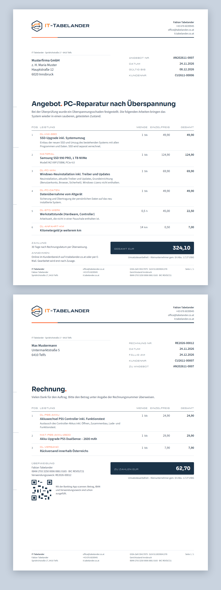

# IT-Tabelander PDF (Dolibarr-Modul `ittabelanderpdf`)

Belege im Werkbank-Design von IT-Tabelander, mit den echten Markenschriften, dazu passende E-Mail-Vorlagen und ein verzögerter, abbrechbarer automatischer Versand.

Modulnummer **756230** · Version 1.0.9 · getestet mit Dolibarr 23.0.3 (PHP 8.2) · Mindestversion Dolibarr 21, PHP 7.4



## Was das Modul kann

PDF-Vorlage **werkbank** für:

| Belegart | Titel im PDF | Besonderheiten |
| --- | --- | --- |
| Angebot | „Angebot.“ | Gültig bis, Annehmen-Text, Unterschriftszeile, leeres Signaturfeld bei `MAIN_PDF_PROPAL_USE_ELECTRONIC_SIGNING` |
| Rechnung | „Rechnung.“, „Anzahlungsrechnung.“, „Ersatzrechnung.“, „Gutschrift.“ | Leistungsdatum (§ 11 UStG), Überweisung mit EPC-QR-Code (GiroCode), Teilzahlungen („Bereits bezahlt“, „Offen“), Gutschrift mit „Zu Rechnung“ und „Erstattet“ |
| Auftrag | „Auftragsbestätigung.“ | Liefertermin, Zu Angebot |
| Lieferung | „Lieferschein.“ | ohne Preise, Bestellt/Geliefert, Versandart, Sendungsnummer, Unterschrift „Ware erhalten“ |
| Serviceauftrag | „Arbeitsbericht.“ (ohne Einsätze „Serviceauftrag.“) | Einsätze mit Datum und Dauer, Gesamtdauer, zwei Unterschriftszeilen |
| Vertrag | „Vertrag.“ | Mindestlaufzeit, Kündigungsfrist, je Leistung Beginn, Ende geplant, Abrechnungsintervall |
| Lieferanten-Preisanfrage | „Preisanfrage.“ | Mengen ohne Preise |
| Lieferantenbestellung | „Bestellung.“ | Lieferantenreferenzen, Lieferadresse |
| Wareneingang | „Wareneingang.“ | intern, Bestellt/Erhalten, Prüfzeile |

Für alle gilt: Kopf mit Logo und Kontakt, Falzmarken, Anschrift nach DIN 5008 (Dolibarr-Funktion `pdf_build_address`, Kontakt als „z. H.“), Infoblock, Titel mit Kundenreferenz, Einleitung aus der öffentlichen Notiz, Tabelle ohne senkrechte Linien, Summenblock, Fußtext der Belegart (`PROPOSAL_FREE_TEXT`, `INVOICE_FREE_TEXT`, … mit Variablen), Fuß mit Firmendaten auf jeder Seite, „Seite x / y“. Mehrseitig: Folgeseiten mit kleinem Kopf, Tabellenkopf wiederholt, Summen-/Zahlungsblock wird nie geteilt. Entwürfe bekommen das Dolibarr-Wasserzeichen (`PROPALE_DRAFT_WATERMARK`, `FACTURE_DRAFT_WATERMARK`, …).

Ist die Firma nicht umsatzsteuerpflichtig (Firmeneinstellung „Umsatzsteuer: nein“), steht unter dem Gesamtbetrag der Kleinunternehmer-Hinweis aus den Moduleinstellungen. Ist sie es, zeigt der Summenblock Netto, USt je Satz und Brutto.

**E-Mail-Vorlagen** (Einstellungen → E-Mail-Vorlagen, Modul „ittabelanderpdf“): Angebot, Rechnung, Anzahlungsrechnung, Gutschrift, Zahlungsbestätigung, Auftragsbestätigung, Lieferung, Arbeitsbericht, Vertrag und eine allgemeine Nachricht, jeweils als „(Sie)“ und „(Du)“; Preisanfrage und Bestellung an Lieferanten neutral; „Ticket-Antwort“ (Text mit Gruß und Benutzer-Signatur `__USER_SIGNATURE__`, die Einleitung kommt aus den Ticket-Einstellungen). **Eingangsbestätigung für neue Tickets:** Statt Dolibarrs eingebautem Text schickt das Modul eine eigene Bestätigung im selben Aufbau wie Angebot und Rechnung (Logo, Anrede nach Du/Sie, Nummer und Betreff in der Box, Link zum Stand, Gruß, Fußzeile, hell und dunkel; den Anfragetext nicht, weil er interne Hinweise der Website enthalten kann). Die Benachrichtigung an `TICKET_NOTIFICATION_EMAIL_TO` kommt ebenfalls vom Modul, auf Deutsch mit allen Angaben, dem vollen Text und einem Knopf ins Ticket. Schlägt ein Versand fehl, geht Dolibarrs eigene Mail raus. Abschalten: Konstante `ITTABPDF_TICKET_CONFIRM` = 0. Vorhandene Vorlagen werden nie überschrieben. Werkbank-Fassungen der Mahnwesen- und Ticket-Texte für die Produktion liegen in `docs/rollout/`, die Schritte in `docs/ROLLOUT.md`.

**Automatischer Versand** für: Angebot freigegeben (mit PDF), Rechnung freigegeben (mit PDF; Gutschrift und Anzahlungsrechnung mit eigener Vorlage), Rechnung vollständig bezahlt (Zahlungsbestätigung ohne Anhang). Der Versand geht erst nach einer Verzögerung (Standard 5 Minuten) hinaus und lässt sich bis dahin auf der Karte des Belegs abbrechen.

## Installation

1. `module_ittabelanderpdf-1.0.9.zip` in Dolibarr hochladen: **Start → Einstellungen → Module/Anwendungen → Reiter „Externes Modul bereitstellen“**.
2. In der Modulliste **IT-Tabelander PDF** aktivieren. Dabei passiert:
   - die Vorlage `werkbank` wird für alle neun Belegarten eingeschaltet (noch nicht als Standard),
   - Zusatzfelder: Kunde/Lieferant „Anrede per Du“ (`ittab_du`), Vertrag „Mindestlaufzeit (Monate)“ (`ittab_mindestlaufzeit`) und „Kündigungsfrist“ (`ittab_kuendigungsfrist`),
   - 23 E-Mail-Vorlagen, die Tabelle `llx_ittabpdf_mailqueue`, der geplante Job „IT-Tabelander PDF: automatic e-mails“ (alle 5 Minuten),
   - Menüeintrag **Rechnungen → Automatischer Versand**.

## Aktivierung als Standardvorlage

In der Einstellungsseite jeder Belegart unter **Dokumentvorlagen** bei `werkbank` das Häkchen „Standard“ setzen:

| Belegart | Weg |
| --- | --- |
| Angebote | Einstellungen → Module → Angebote (Zahnrad) → Dokumentvorlagen |
| Rechnungen | Einstellungen → Module → Rechnungen (Zahnrad) → Dokumentvorlagen |
| Aufträge, Lieferungen, Serviceaufträge, Verträge, Preisanfragen, Lieferantenbestellungen, Wareneingänge | jeweils die Einstellungsseite des Moduls |

Bereits erzeugte PDFs bleiben, wie sie sind; neu erzeugen über „Erzeugen“ auf der Belegkarte (dort kann auch jede andere Vorlage gewählt werden).

Damit die Rechnung Kontodaten und QR-Code zeigt, muss bei den Rechnungseinstellungen das Bankkonto für Überweisungen gewählt sein (`FACTURE_RIB_NUMBER`), mit IBAN, BIC und Kontoinhaber. Kopf und Fuß nehmen Name, Manager, Mobilnummer, E-Mail, Web, Adresse und die Berufs-IDs aus **Einstellungen → Firma/Organisation** (Berufs-ID 2 = Gerichtsstand, 4 und 6 = z. B. GISA-Zahl und GLN, so wie sie dort stehen).

## Moduleinstellungen

**Einstellungen → Module → IT-Tabelander PDF (Zahnrad)**:

- Kundenbereich der Website aktiv (Standard: aus). Steuert den Annehmen-Text im Angebots-PDF, den Satz in den Angebotsmails und den Button „Im Kundenbereich ansehen“ in allen Kunden-Mails.
- Text „Annehmen“ auf Angeboten mit Kundenbereich (Standard: „Online im Kundenbereich auf it.tabelander.co.at oder per E-Mail. Gearbeitet wird erst nach Zusage.“) und ohne (Standard: „Bitte kurz per E-Mail an __MYCOMPANY_EMAIL__ bestätigen. Gearbeitet wird erst nach Zusage.“, die Variable wird durch die Firmen-E-Mail ersetzt)
- Kleinunternehmer-Hinweis unter dem Gesamtbetrag (Standard: „Umsatzsteuerbefreit – Kleinunternehmer gem. § 6 Abs. 1 Z 27 UStG“)
- **Modul-Vorlagen auf aktuellen Stand bringen** (mit Rückfrage): ersetzt Betreff und Inhalt aller Vorlagen dieses Moduls; eigene Vorlagen und die anderer Module bleiben unberührt. Beim Aktivieren werden Modul-Vorlagen, die noch den Text einer früheren Version haben, automatisch erneuert.
- Automatischer Versand je Anlass ein/aus (Standard: aus), Verzögerung in Minuten (Standard 5), Blindkopie an (Standard: E-Mail der Firma), Adresse des Kundenbereichs, Vorlage je Anlass für Sie und Du (Standard: die Vorlagen des Moduls).

## Automatischer Versand im Betrieb

- Beim Freigeben bzw. bei vollständiger Bezahlung legt das Modul einen Eintrag an; auf der Karte steht dann „Automatischer Versand geplant um HH:MM“ mit **Abbrechen**.
- Der geplante Job schickt fällige Einträge. Vorher prüft er, ob der Beleg noch passt (Angebot noch offen, Rechnung nicht wieder Entwurf, Rechnung noch bezahlt); sonst wird der Eintrag abgebrochen.
- Empfänger: Rechnungskontakt (Rechnungen) bzw. Kundenkontakt (Angebote), sonst die E-Mail-Adresse des Kunden. Fehlt beides, steht der Eintrag auf „Fehler“ und die Karte zeigt das mit **Erneut senden**.
- Anrede: „Anrede per Du“ beim Kunden → Du-Vorlage, sonst Sie.
- Das PDF wird vor dem Versand mit `werkbank` neu erzeugt. Nach dem Versand steht in der Ereignisliste des Belegs derselbe Eintrag wie bei einem händischen Versand (`PROPAL_SENTBYMAIL` bzw. `BILL_SENTBYMAIL`, mit Empfänger, Betreff, Anhang).
- Ein Beleg wird je Anlass nur einmal automatisch verschickt, auch wenn er zurück auf Entwurf und erneut freigegeben wird. Nur abgebrochene oder fehlgeschlagene Einträge werden bei einer neuen Freigabe wieder geplant.
- Übersicht: **Rechnungen → Automatischer Versand** (Geplant/Gesendet/Fehler/Abgebrochen, Abbrechen, Erneut senden).
- Voraussetzung: Dolibarrs Cron läuft auf dem Server (z. B. alle 5 Minuten `scripts/cron/cron_run_jobs.php`) und der Job ist unter **Einstellungen → Geplante Jobs** aktiv.

## E-Mail-Variablen des Moduls

Zusätzlich zu Dolibarrs eigenen Variablen (`__REF__`, `__MYCOMPANY_NAME__`, …):

| Variable | Inhalt |
| --- | --- |
| `__ITTAB_HALLO__` | „Hallo Maria,“ (Vorname des Kontakts; bei Privatkunden ohne Kontakt das erste Wort des Namens) |
| `__ITTAB_GUTENTAG__` | „Guten Tag Frau Muster,“ / „Guten Tag,“ |
| `__ITTAB_FAKTEN__` | Kasten mit Belegnummer, Betrag, Fällig am / Gültig bis usw. |
| `__ITTAB_UEBERWEISUNG__` | Kontoinhaber, IBAN, BIC, Verwendungszweck (nur bei offener Rechnung) |
| `__ITTAB_SENDUNG__` | Sendungsnummer mit Link (nur Lieferungen mit Sendungsnummer) |
| `__ITTAB_KUNDENBEREICH_URL__` | Link auf den Beleg im Kundenbereich der Website (Angebot, Rechnung/Gutschrift, Auftrag, Lieferschein, Arbeitsbericht, Vertrag; sonst die Startseite) |
| `__ITTAB_KUNDENBEREICH_BLOCK__` | Button „Im Kundenbereich ansehen“, leer solange „Kundenbereich der Website aktiv“ aus ist |
| `__ITTAB_FRAGEN_SATZ__`, `__ITTAB_FRAGEN_SATZ_DU__` | Wie man fragt (Sie/Du): „einfach auf diese E-Mail antworten“, mit Kundenbereich zusätzlich „oder im Kundenbereich schreiben“. Kein Telefon-Satz; die Nummer steht nur in der Fußzeile |
| `__ITTAB_ANNAHME_SATZ__`, `__ITTAB_ANNAHME_SATZ_DU__` | Satz zur Annahme des Angebots (Sie/Du): mit Kundenbereich „online im Kundenbereich annehmen oder antworten“, ohne „einfach auf diese E-Mail antworten“ |
| `__ITTAB_LOGO__` | Firmenlogo als verlinktes Bild auf Weiß: `public/maillogo.php` des Moduls liefert das Logo der Firmeneinstellungen als undurchsichtiges PNG auf weißem Grund (ohne Anmeldung, zwischengespeichert), oder die Adresse aus `ITTABPDF_MAIL_LOGO_URL`. Ohne Logo: Wortmarke als Text |
| `__ITTAB_TELEFON_LINK__` | Telefonnummer als eigener `tel:`-Link in neutraler Farbe |

**Hell und dunkel.** Die Vorlagen enthalten nur Blöcke mit Inline-Stilen, kein `<style>` und keine Tabellen: Dolibarrs WAF lehnt `<style` in jedem Formular ab (Speichern der Vorlage und händischer Versand), und der Bereinigungsfilter `restricthtml` entfernt Klassen. Diese helle Fassung gilt für jeden Versandweg und bleibt auch dann sauber, wenn ein Mail-Programm sie selbst abdunkelt (das Logo ist ein undurchsichtiges weißes Schild). Nur der automatische Versand legt um den Text ein ganzes Dokument mit `color-scheme`, `@media (prefers-color-scheme: dark)` und den Outlook-Selektoren `[data-ogsc]`/`[data-ogsb]`: Hintergrund #0D1823, Kasten #14263A, Texte #EEF2F6/#C5D0DC/#A9B8CA, Linie #2C4763, dazu das helle Logo für dunkle Flächen (`ITTABPDF_MAIL_LOGO_DARK`, Pfad im DMS; `public/maillogo.php?variant=dark`). Die dunklen Regeln finden die Elemente über ihre Inline-Farben, deshalb wirken sie auch auf Text, der später direkt in der Vorlage geändert wird.
| `__ITTAB_INHABER__`, `__ITTAB_TELEFON__`, `__ITTAB_ADRESSE__`, `__ITTAB_WEB__`, `__ITTAB_RECHTLICHES__` | Firmendaten für Gruß und Fuß |

Das Logo wird verlinkt, nicht eingebettet. Eingebettete Bilder (`data:` → `cid:`) zeigt Dolibarrs SMTPS-Versand auf Handy-Mailprogrammen als kaputtes Bild plus zusätzlichen Anhang (24.11.2026 in Produktion gesehen). Voraussetzung: Dolibarr ist von außen erreichbar. Wird es gesperrt (Website-Issue #67), `ITTABPDF_MAIL_LOGO_URL` (Einstellungen → Erweiterte Einstellungen) auf eine öffentliche Adresse setzen, z. B. ein PNG auf it.tabelander.co.at. Die Mails sind immer hell wie das PDF (`color-scheme: light only`, weiße Flächen und Textfarben fest im HTML); Programme mit erzwungenem Dunkelmodus können Flächen trotzdem umfärben, das Logo bleibt aber ein Bild auf Weiß und damit lesbar.

Die Vorlagen nutzen bewusst keinen Online-Zahlungslink (`__ONLINE_PAYMENT_URL__`); der lässt sich bei Bedarf in der Vorlage ergänzen.

## Elektronische Signatur

`pdf_cyan` legt bei `MAIN_PDF_PROPAL_USE_ELECTRONIC_SIGNING` ein leeres Signaturfeld an und schreibt die Seite mit dem Unterschriftsbereich als `PAGESIGN=n` in die Schlüsselwörter. `werkbank` macht beides, an der Unterschriftszeile „Datum, Unterschrift Auftraggeber“. Dolibarrs öffentliche Online-Signaturseite setzt das Unterschriftsbild dagegen immer an eine feste Stelle (x 120 mm, 60 mm über dem unteren Rand, änderbar über `PROPAL_SIGNATURE_XFORIMGSTART`/`YFORIMGSTART`). Weil der Unterschriftsbereich bei `werkbank` mit dem Inhalt mitwandert, trifft dieses Bild die Linie nicht genau. Angenommen wird bei IT-Tabelander über den Kundenbereich der Website; die Online-Signaturseite von Dolibarr ist dafür nicht nötig.

## Grenzen

- Eine einzelne Tabellenzeile, die länger als eine ganze Seite ist, wird nicht geteilt.
- Titel- und Zwischensummenzeilen des Moduls „Subtotal“ erscheinen als einfache Textzeilen ohne Beträge.
- Nicht übernommen aus `cyan`/`sponge`: Produktfotos, Incoterms, zweite Belegsprache (`PDF_USE_ALSO_LANGUAGE_CODE`), angehängte AGB-PDFs, Zusatzfelder der Zeilen, Fremdwährungsbeträge (alle Beträge in der Firmenwährung).
- Der Fußtext darf allein auf eine neue Seite rutschen, wenn er nicht mehr passt (der Summenblock nicht).
- Die E-Mail-Vorlagen sind deutsch (gelten für alle Sprachen).

## Entwicklung

```bash
python scripts/dev_dolibarr.py all     # Dolibarr 23.0.3 + MariaDB + Mailpit, Modul aus dem ZIP, Testdaten, PDFs, Mails, Oberfläche
python scripts/dev_dolibarr.py down    # Container wieder weg
python scripts/build_release.py        # dist/module_ittabelanderpdf-x.y.z.zip + .sha256
python scripts/build_fonts.py          # fonts/ neu aus den WOFF-Dateien (nur bei Schriftwechsel)
```

Beispiel-PDFs liegen in `docs/beispiele/`, die Mails als HTML in `docs/beispiele/mails/` (`uebersicht.json`: Empfänger, BCC, Anhänge, Prüfergebnisse).

## Lizenz

Code: GPL-3.0-or-later (`LICENSE`). Schriften Sora, Source Sans 3 und Michroma: SIL Open Font License 1.1 (`fonts/LICENSE-*.txt`).
